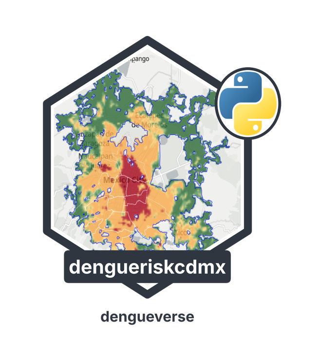

<div class="hero" markdown>

</div>

[](license.md)
[](https://www.python.org/)
[](https://pypi.org/project/dengueriskcdmx/)
[](https://fdzul.github.io/dengueriskcdmx/)
[](https://github.com/fdzul/dengueriskcdmx-py)

# dengueriskcdmx

Data and rasters supporting the **Risk Map of Dengue Transmission in the Metropolitan Area of Mexico City**. This is the Python version of the R package [`dengueriskcdmx`](https://fdzul.github.io/dengueriskcdmx/); it ships the same data sets and rasters.

## Installation

```bash
pip install dengueriskcdmx            # data loaders (GeoPandas)
pip install "dengueriskcdmx[raster]"  # plus rasterio, to read the rasters
```

## What is included

| Function | Returns |
|---|---|
| `load_ae_aegypti("all")` | *Ae. aegypti* ovitrap presences and pseudo-absences, 2017-2024, with the `split` column (train / test) |
| `load_ae_aegypti("train")` / `("test")` | Training (80%) and test (20%) partitions |
| `load_ae_aegypti("external")` | External validation data, 2025 |
| `load_aoi()` | Study area (Mexico City Metropolitan Area) |
| `ae_raster_path(layer)` / `read_raster(layer)` | Path to / open GeoTIFF of `"aedes"`, `"dengue"` or `"risk"` |

!!! note "Data availability"
    The ovitrap data are included. The data on confirmed dengue cases used to fit the case model are **not** published; only the derived probability and risk rasters are provided.
